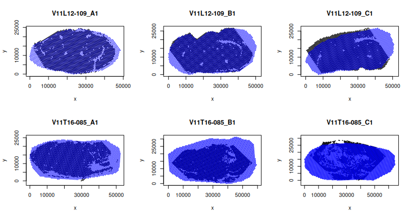
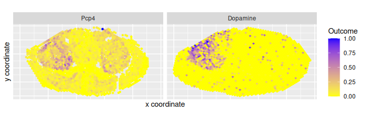
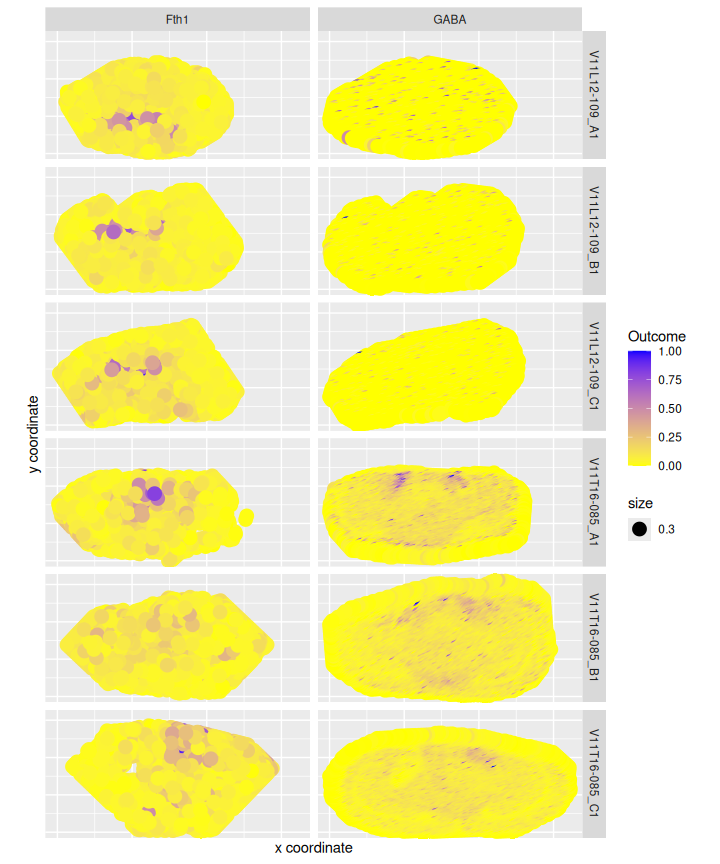

SBIVAR: Spatial BIVARiate association tests across disjoint coordinate
sets
================

This repo provides code for performing bivariate association tests
between different spatial modalities measured on the same or consecutive
slices, possibly with disjoint coordinate sets. A common coordinate
framework as obtained from alignment is considered given. An extensive
description of the methods is available in our
[preprint](https://www.biorxiv.org/content/10.64898/2026.06.19.732250v1).

The package can be installed from GitHub (with suggested packages
through dependencies = TRUE) as follows:

``` r
remotes::install_github("sthawinke/sbivar", build_vignettes = TRUE, dependencies = TRUE)
```

Once installed, you can load the package

``` r
library(sbivar)
```

As example dataset, we use the one by [Vicari et
al. (2024)](https://doi.org/10.1038/s41587-023-01937-y), which includes
replicated measurements of spatial transcriptomics and metabolomics
coprofiled on mouse brain sections. A subset of the data is available in
the *sbivar* package and can be loaded as:

``` r
data(Vicari)
```

This object consists of four lists of length six: *MetaboliteCoords* and
*TranscriptCoords* for the coordinates, and *TranscriptOutcomes* and
*MetaboliteOutcomes* for the feature measurements. Have a look at the
aligned coordinates:

``` r
par(mfrow = c(2, 3))
plotCoordsMulti(Vicari$TranscriptCoords, Vicari$MetaboliteCoords, cex = 0.1)
```

<!-- -->

``` r
par(mfrow = c(1, 1))
```

## Single-image analysis

The Vicari data consist of six images which could be analysed jointly,
but for didactical purposes we also analyse a single image here, the
sample “V11L12-109_A1”.

``` r
singleSample <- "V11L12-109_A1"
singleStxCoords <- Vicari$TranscriptCoords[[singleSample]]
singleStx <- Vicari$TranscriptOutcomes[[singleSample]]
singleMetCoords <- Vicari$MetaboliteCoords[[singleSample]]
singleMet <- Vicari$MetaboliteOutcomes[[singleSample]]
```

Prepare multithreading

``` r
library(BiocParallel)
nCores <- 2
if (.Platform$OS.type == "unix") {
    # On unix-based systems (linux and macOS), use MulticoreParam
    register(MulticoreParam(nCores, stop.on.error = FALSE))
} else {
    # On windows, use SnowParam
    register(SnowParam(workers = nCores, type = "SOCK", stop.on.error = FALSE))
}
```

Now analyse this single sample using bivariate Moran’s I.

``` r
moranRes <- sbivar(singleStx, singleMet, singleStxCoords, singleMetCoords,
    method = "Moran's I"
)
```

    ## Starting sbivar analysis of a single image on 2 computing cores

    ## Testing significance of bivariate Moran's I for 25 feature pairs

    ## Calculating bivariate Moran's I statistics ...

    ## Fitting variograms for first modality (5 features) ...

    ## Fitting variograms for second modality (5 features) ...

    ## Calculating variances of bivariate Moran's I statistics ...

Have a look at the results:

``` r
topPairs(moranRes) 
```

    ##  Modality_X Modality_Y   Ixy_5e.06   Ixy_2e.04    Ixy_0.02 SE.Ixy._5e.06
    ##        Pcp4   Dopamine  1.6911e-04  1.3134e-04  6.2155e-05    4.4711e-05
    ##     mt.Atp6  Histidine  5.1749e-05  2.6285e-05  6.8162e-06    1.8255e-05
    ##        Fth1  Histidine -1.4560e-05 -2.6245e-05 -1.0001e-05    1.8233e-05
    ##        Pcp4  Histidine  2.9816e-05  1.2368e-05  3.0388e-06    1.8231e-05
    ##        Fth1 Tocopherol -1.4136e-05 -1.4226e-05 -3.4510e-06    1.8120e-05
    ##     mt.Atp6    Taurine  1.4864e-06  1.4809e-05  4.8180e-06    1.8120e-05
    ##  SE.Ixy._2e.04 SE.Ixy._0.02       pVal     pAdj
    ##     4.1477e-05   2.8766e-05 0.00042165 0.010541
    ##     7.4558e-06   3.7288e-06 0.00115480 0.014435
    ##     7.8309e-06   3.3908e-06 0.00192460 0.016038
    ##     6.8695e-06   3.3904e-06 0.11680000 0.431010
    ##     7.5655e-06   2.8744e-06 0.13618000 0.431010
    ##     7.1162e-06   3.1462e-06 0.14621000 0.431010

Plot the most significantly spatially associated gene-metabolite pair
Pcp4–Dopamine:

``` r
plotTopPair(moranRes, singleStx, singleMet, singleStxCoords, singleMetCoords)
```

<!-- -->

Write the results to a spreadsheet

``` r
writeSbivarToXlsx(moranRes, file = "myfile.xlsx")
```

## Multi-image analysis

Next, we analyse the six images jointly. First construct a variable
identifying the mouse, consisting of the first 10 characters of the
names:

``` r
mouse <- substr(names(Vicari$TranscriptOutcomes), 1, 10)
```

For the multi-image case, we use GAMs as measure of spatial association,
with a negative binomial outcome distribution for the transcriptome
data, and a gamma outcome distribution for the metabolome data. A
log-link is used in both cases.

``` r
multiGAMRes <- sbivar(
    X = Vicari$TranscriptOutcomes, Y = Vicari$MetaboliteOutcomes,
    Cx = Vicari$TranscriptCoords, Ey = Vicari$MetaboliteCoords,
    method = "GAMs", control = list("families" = list("X" = mgcv::nb(), "Y" = Gamma(lin = "log")))
)
```

    ## Starting sbivar analysis (GAMs) of 6 images on 2 computing cores

    ## Image 1 of 6

    ## Image 2 of 6

    ## Image 3 of 6

    ## Image 4 of 6

    ## Image 5 of 6

    ## Image 6 of 6

Next we plug the calculated correlations between the spline surfaces
into a linear model, with random effects for the individual mice:

``` r
design <- data.frame("mouse" = mouse)
multiGAMLmms <- fitLinModels(multiGAMRes, design, Formula = ~ (1 | mouse))
```

    ## Fitting 25 mixed effects models on 2 cores

Extract the results for the desired parameter (the intercept)

``` r
multiGAMLmmsRes <- extractResultsMulti(multiGAMLmms, design)
topPairs(multiGAMLmmsRes, parameter = "Intercept")
```

    ##  Modality_X Modality_Y Estimate       SE      pVal    pAdj
    ##        Fth1       GABA  0.41259 0.102160 0.0099346 0.16170
    ##       Sparc Tocopherol -0.19695 0.055128 0.0160010 0.16170
    ##     mt.Atp6       GABA -0.42308 0.124700 0.0194040 0.16170
    ##       Sparc    Taurine -0.37367 0.120220 0.0266060 0.16629
    ##        Gnas   Dopamine -0.25795 0.102370 0.0531940 0.22077
    ##        Gnas Tocopherol  0.20587 0.083767 0.0573990 0.22077

No features are significantly associated after multiplicity correction.
For illustration, we plot the feature pair with the smallest p-values
nevertheless:

``` r
plotTopPair(multiGAMLmmsRes,
    Xl = Vicari$TranscriptOutcomes, Yl = Vicari$MetaboliteOutcomes,
    Cxl = Vicari$TranscriptCoords, Eyl = Vicari$MetaboliteCoords
)
```

<!-- -->

A more extensive description of the sbivar functionality can be found in
the vignette, accessed by calling

``` r
browseVignettes("sbivar")
```
